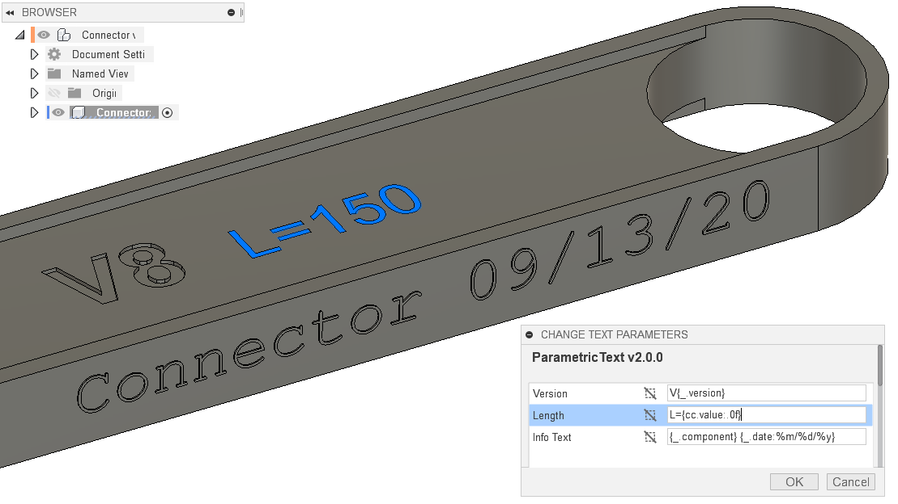

#  ParametricText

ParametricText is an Autodesk® Fusion add-in for creating *Text Parameters* in sketches.



## Supported Platforms

* Windows
* Mac OS

## Documentation

https://parametrictext.readthedocs.io/en/stable/

## More Fusion Add-ins

[My Fusion app store page](https://apps.autodesk.com/en/Publisher/PublisherHomepage?ID=JLH9M8296BET)

[All my add-ins on Github](https://github.com/topics/fusion-360?q=user%3Athomasa88)

## Development

### Building the documentation

```
cd doc
python3 -m venv venv # First time
. venv/bin/activate
python3 -m pip install -r requirements.txt # First time
make html
ls _build/html
```

### Running tests

Run `python3 -m unittest` to execute all unit tests.
### Packaging a Community Store download

For a stable release, run the existing `thomasa88lib/make-addin-release.sh`
from the tagged checkout with submodules initialized. Alongside the usual
GitHub download, attach a copy of the generated `ParametricText-vX.Y.Z-AppStore.zip`
named `ParametricText-vX.Y.Z-universal.zip` to the GitHub release.

This ZIP has the matching `ParametricText/` folder, manifest and entry point,
and includes the pinned library and icons. Community Store prefers the
`-universal.zip` asset. Existing manual installations can continue using
the regular GitHub ZIP with its original folder name.
